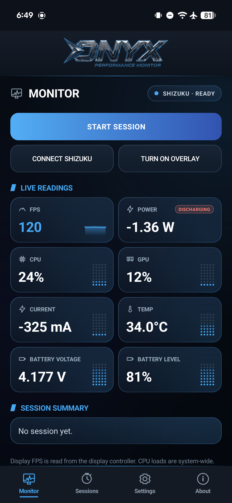
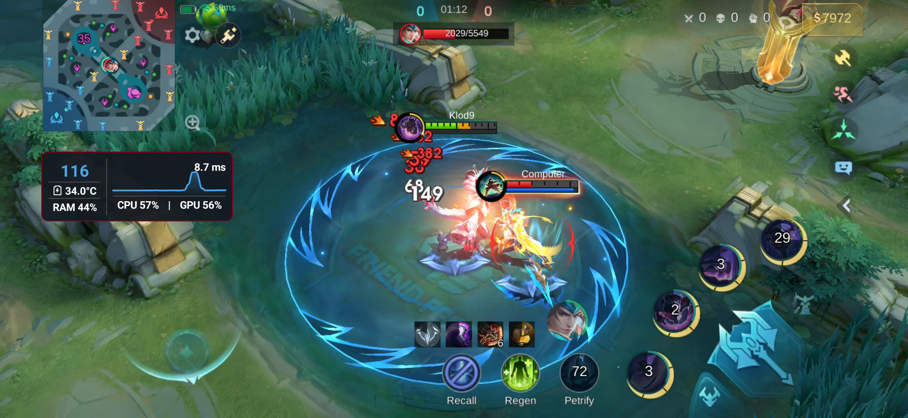
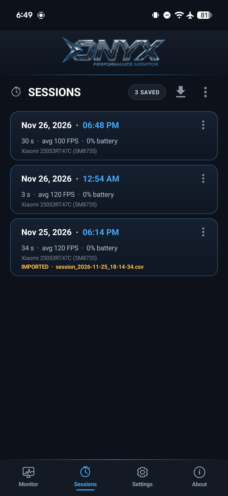
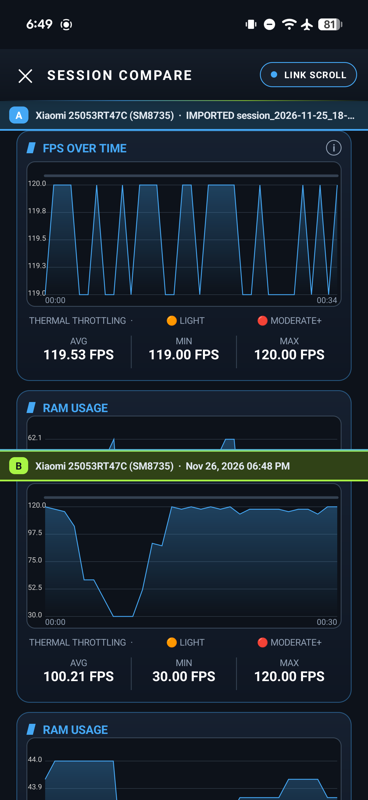
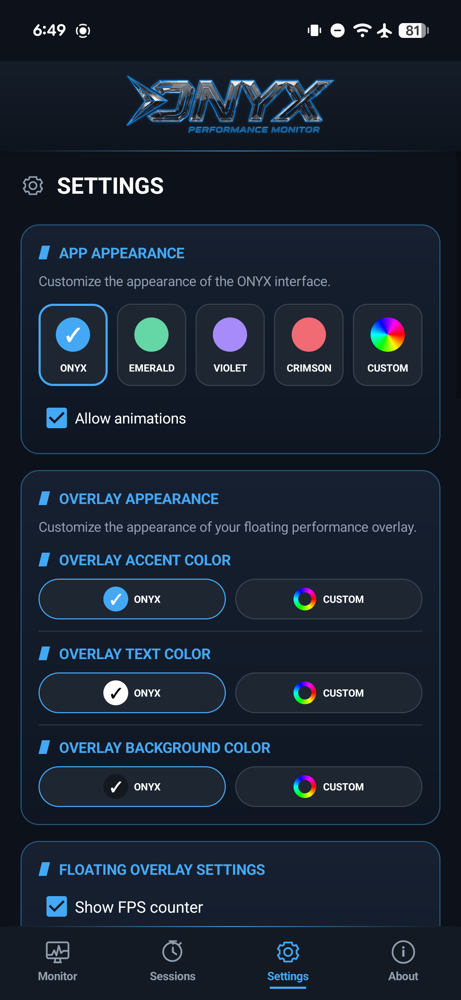
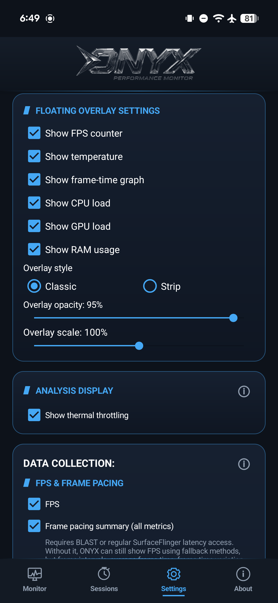
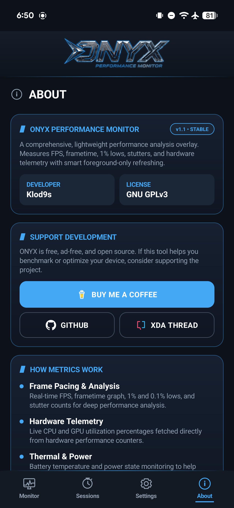

# ONYX Performance Monitor

ONYX is a free, open-source Android performance monitor with **no ads and no user tracking/analytics**. It provides real-time FPS, frame pacing, hardware telemetry, battery power, and session analysis through a configurable floating overlay, supporting privileged data access via **Shizuku** or **root**.

## Screenshots

### Monitor Dashboard
<p align="center">
  
</p>


### Floating Overlay in Gameplay




### Session Recording & Comparison
<p align="center">
  
  
</p>

### Customization & Settings
<p align="center">
  
  
  
</p>

## Features

### Live performance monitoring
- **FPS monitoring** with multiple detection methods and fallbacks: SurfaceFlinger BLAST/frame latency, display FPS, SurfaceFlinger frame counters, and TimeStats.
- **Frame pacing metrics** when frame presentation timestamps are available: average frame time, frame-time variation, stutter count, and 1% / 0.1% frame lows.
- **CPU telemetry** including per-core utilization and frequency, plus CPU temperature when exposed by the device.
- **GPU telemetry** including utilization, frequency, and temperature when exposed by the device.
- **Memory monitoring** with RAM usage.
- **Battery and power telemetry** including battery level, current, voltage, power, and temperature.
- **Thermal diagnostics** using Android thermal status and cooling-device activity when available.

### Floating performance overlay
- Show or hide FPS, temperature, frame-time graph, CPU load, GPU load, and RAM usage independently.
- Choose the overlay style and adjust its size and opacity.
- Drag the overlay to position it on screen.
- Customize overlay accent, text, and background colors.
- Start and stop session recording from the overlay.

### Session recording and analysis
- Record performance sessions from the app or floating overlay.
- Save sessions as CSV files, with device and Android information where available.
- Browse, import, export, compare, and delete saved sessions.
- View a frame-pacing summary with average frame time, frame-time variation, stutters, FPS stability, and 1% / 0.1% frame lows when the required frame data is available.
- Explore session charts for FPS, RAM, CPU core load and frequency, GPU load and frequency, CPU/GPU temperatures, and battery metrics.
- Review battery drain intervals and recorded thermal-throttling periods.
- Export a complete session analysis as a PNG image.
- Compare two sessions in synchronized panes: stacked in portrait and side-by-side in landscape, with linked scrolling.

### Customization and data controls
- Choose an app accent preset: **ONYX**, **Emerald**, **Violet**, or **Crimson**, or use a custom color.
- Configure which metrics are collected and saved to session files.
- Toggle thermal-throttling indicators in session analysis and comparison independently of thermal data collection.
- Enable or disable app animations.

### Efficient sampling
ONYX avoids unnecessary continuous sampling while idle. Monitoring is active when a session is being recorded or the floating overlay needs live readings; foreground UI updates are handled separately from background recording.

## Requirements

- **Android 8.0 (API 26) or higher.**
- **Android 14 or higher recommended.**
- [Shizuku](https://shizuku.rikka.app/) installed, running, and authorized for ONYX, **or** a rooted device with root access granted.

> **Device compatibility:** Available metrics depend on the device, Android version, kernel, vendor implementation, and access permissions. Some devices may not expose particular CPU/GPU temperatures, frequencies, utilization values, thermal diagnostics, or frame-level timestamps. When a frame-timestamp source is unavailable, ONYX may fall back to a display-level FPS source; frame-pacing statistics that require individual frame intervals may then be unavailable.

## Tested Devices

ONYX has been tested on the following devices and environments:

- **Redmi Turbo 4 Pro** — LineageOS 23.2 (Android 16)
- **Honor 400 Pro** — Android 16 / Android 17
- **Lenovo Legion Y70 (2026)** — Android 16 / Android 17
- **iQOO Z9x** — Android 14

## Installation

ONYX supports two methods for privileged access.

### Method 1: Shizuku

1. Install and set up [Shizuku](https://shizuku.rikka.app/).
2. Start the Shizuku service.
3. Install and open ONYX.
4. Tap **Connect Shizuku**.
5. Grant ONYX permission when prompted.

### Method 2: Root

1. Install and open ONYX.
2. Grant root access when prompted by your root manager (for example, Magisk).

## Building from Source

1. Clone the repository:

   ```bash
   git clone https://github.com/Klod9s/ONYX.git
   cd ONYX
   ```

2. Build the debug APK.

   **Windows:**
   ```powershell
   .\gradlew.bat assembleDebug
   ```

   **Linux / macOS:**
   ```bash
   ./gradlew assembleDebug
   ```

3. Find the APK at:

   ```
   app/build/outputs/apk/debug/app-debug.apk
   ```

To run the unit tests:

**Windows:**
```powershell
.\gradlew.bat testDebugUnitTest
```

**Linux / macOS:**
```bash
./gradlew testDebugUnitTest
```

## License

ONYX is licensed under the **GNU General Public License v3.0 or later (GPL-3.0-or-later)**.

See [LICENSE](LICENSE) for the complete license text.
